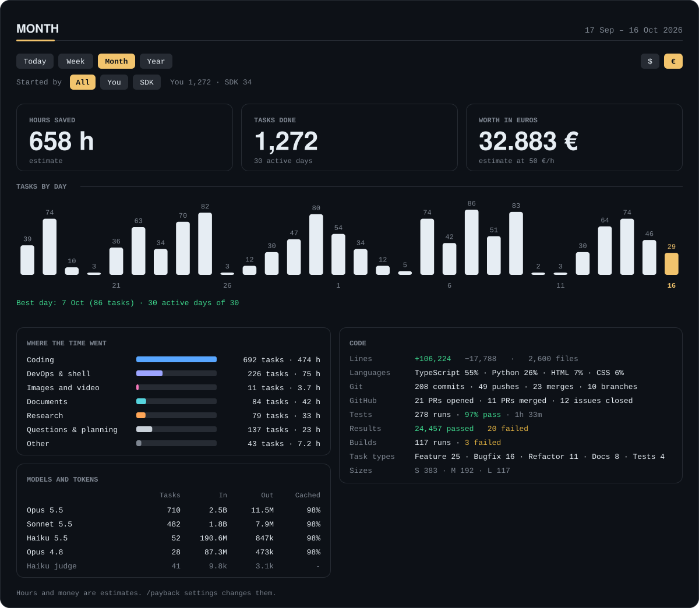
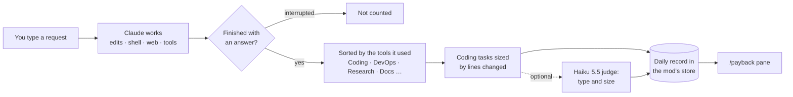

<p align="center">
  
</p>

<p align="center">
  <a href="LICENSE"></a>
  <a href="https://code.claude.com/docs/en/plugins/mods/overview"></a>
  
  <a href="https://github.com/michaelSelbertinger/payback/stargazers"></a>
</p>

<p align="center">
  <b>Payback</b> is a <a href="https://code.claude.com/docs/en/plugins/mods/overview">Claude Code mod</a> that counts what Claude finished for you,<br>
  sorts it, reads your git and test activity, and estimates the hours and money it saved.
</p>

<p align="center">
  <a href="#install">Install</a> ·
  <a href="#what-you-get">What you get</a> ·
  <a href="#how-it-counts">How it counts</a> ·
  <a href="#importing-your-history">Import history</a> ·
  <a href="#commands">Commands</a>
</p>

---

## Install

```
/plugin install payback --marketplace michaelSelbertinger/payback
```

Then type `/payback`. Want your past sessions in the report too? Run `/payback import` once. A mod installs like any plugin, through the normal marketplace flow; if you install from a shell while a session is open, run `/reload-plugins` there to load it.

<details>
<summary>From a shell, or in the desktop app</summary>

<br>

From a shell, with Claude Code 2.1.292 or later:

```
claude plugin install payback --marketplace michaelSelbertinger/payback
```

On an older version, add the marketplace first and then install:

```
claude plugin marketplace add michaelSelbertinger/payback
claude plugin install payback@payback
```

In the desktop app, where `/plugin` does not run: click **+** next to the prompt box, then **Plugins**, **Add marketplace** with `michaelSelbertinger/payback`, then **Add plugin**.

</details>

> [!NOTE]
> Payback is a [mod](https://code.claude.com/docs/en/plugins/mods/overview): a plugin that changes how Claude Code looks and behaves. Mods need Claude Code **2.1.287 or later** in the terminal (2.1.286 in the desktop app). Payback was built and tested on **2.1.299**, and the mods API is young enough to change between releases.

## See it

<p align="center">
  
</p>

<p align="center"><sub>The pane on the Month tab, in euro, with <b>invented sample data</b>. Above it: Today · Week · Month · Year, a $ / € switch and an All · You · SDK filter. The tiles, chart and cards are drawn by the mod itself.</sub></p>

## What you get

| | |
| --- | --- |
| 📈 **Tasks, counted honestly** | One request you typed and Claude finished is one task. Slash commands, helper agents and interrupted requests are not. Tabs for today, the week, the month and the year, with streaks and your best day. |
| 🧑‍💻 **Real developer stats** | Lines added and removed, files touched, languages, commits, pushes, merges, rebases, branches, pull requests and issues, read straight from what Claude ran. |
| ✅ **Tests and builds** | Runs, pass rate, total and average runtime, and passed and failed counts for pytest, jest, vitest, go, cargo, dotnet, npm and more. |
| 🪙 **Tokens per model** | Input, output and the share served from cache, for every model that did the work. |
| ⏱️ **Time and money** | Minutes saved per kind of task, times your hourly rate, in dollars or euro. Always labelled as an estimate. |
| 🕰️ **Your past, imported** | Replays the session transcripts Claude Code already keeps. Preview first, import on one button, undo any time. |
| 🤖 **SDK-aware** | Work done by an assistant or script you run through the Agent SDK is kept apart, with an All · You · SDK filter. |

## How it counts



Each task gets one kind, from the tools it used:

| Kind | When | Minutes saved (default) |
| --- | --- | --- |
| **Coding** | It edited code, ran git, gh, tests or a build, or used a code tool such as Unity or GitHub | by size: 15 / 45 / 120 |
| **DevOps & shell** | It ran shell commands without editing code, or used Docker, Kubernetes or cloud tools | 20 |
| **Emails** | It used a mail tool | 10 |
| **Images and video** | It used an image or video tool, or wrote an image or video file | 20 |
| **Documents** | It used a document, slide or spreadsheet tool, or wrote a document file | 30 |
| **Research** | It searched or read the web | 25 |
| **Questions & planning** | It used no tools, or only read and searched files | 10 |
| **Other** | Anything else | 10 |

The size of a coding task comes from the lines it changed (under 40 small, under 250 medium, larger is large) until the Haiku judge says otherwise.

<details>
<summary><b>What is counted, and how</b> (all plain code, no model involved)</summary>

<br>

- **Code**: lines added and removed, files touched, top languages.
- **Git**: commits, pushes, merges, rebases and new branches, read from Bash and PowerShell commands that succeeded. `git -C`, chained commands and PowerShell's `if ($?)` work; quoted messages and here-strings are ignored, as are dry runs and aborted merges.
- **GitHub**: pull requests opened and merged, issues opened and closed (`gh pr …`, `gh issue …`).
- **Tests**: runs of pytest, jest, vitest, go test, cargo test, dotnet test, npm/pnpm/yarn/bun test and others, with pass rate, runtime and passed and failed counts. A command only counts when the runner is the command itself, so `pip install pytest` is not a test run.
- **Builds**: runs and failures.
- **Tokens**: input, output and cache share per model, helper agents included.

A helper agent's lines, commits, test runs and tokens count, but it never makes a task of its own. Payback counts what Claude did through its own tools, not commits you make yourself in a terminal.

</details>

### Started by you or by the SDK

Sessions started through the Claude Agent SDK (an assistant of your own, a script) are counted apart. The pane shows a **Started by** row with an **All / You / SDK** filter. SDK sessions run from a temp folder are treated as tests and left out, as are requests that only ask Claude to summarise an earlier session.

## The Haiku judge

> [!NOTE]
> On by default, and the only part of Payback that calls a model. Turn it off with `/payback settings judge off`.

When the judge is on, each finished coding task gets one small call to Claude Haiku 5.5. It labels the task's type (feature, bugfix, refactor, tests, debug, docs, devops, review) and its size. The call is sent the first 1,500 characters of your request, the names and counts of the tools it used and the number of lines changed, and it uses your own Claude account or API key. Its tokens are shown in the pane under **Haiku judge**. With the judge off, sizes come from the lines changed alone.

## Importing your history

`/payback import` reads the session transcripts Claude Code keeps in `~/.claude/projects/` and replays them by the same rules as live tracking.

> [!TIP]
> Nothing is saved until you press **Import**. The pane first shows what it found: tasks, days, sessions, kinds and the estimate.

- **No double counting.** It reads only what happened before Payback's first live record, and an import replaces its whole date range, so running it twice counts once. History that a fork or a resume copied into another file is counted once.
- **Undo** with `/payback import undo`.
- Imported coding tasks are sized by lines changed; the Haiku judge is not run on them.

> [!IMPORTANT]
> Claude Code deletes transcripts after 30 days by default, so that is as far back as an import can go. Raise `cleanupPeriodDays` in your settings to keep more from now on.

## Where it runs

| Where | What you get |
| --- | --- |
| **Desktop app, Code tab** | The pane, the hint-line button and every command. This is where Payback was developed and used. |
| **Terminal** | The same pane in a text layout. Covered by automated tests, not yet by daily use. |
| **VS Code extension** | Mods draw there from extension version 2.1.299. Payback has not been tried in it. |
| **`claude -p` and the Agent SDK** | Counting runs, nothing is drawn. |
| **WSL sessions in the desktop app** | Mods do not run there. |

## Commands

| Command | What it does |
| --- | --- |
| `/payback` | Opens the pane. There is also a **Payback** button in the hint line under the prompt. |
| `/payback settings` | Lists the hourly rate, currency, minutes per kind of task and whether the Haiku judge is on. |
| `/payback settings rate 75` | Sets the hourly rate. |
| `/payback settings currency eur` | Shows money in euro (`usd` for dollars). Nothing is converted: the rate is read in the chosen currency. The pane has a `$ / €` switch too. |
| `/payback settings <kind> 15` | Minutes saved per task of a kind: `devops`, `emails`, `images`, `documents`, `research`, `questions`, `other`. |
| `/payback settings small\|medium\|large 45` | Minutes saved per coding task of that size. |
| `/payback settings judge on\|off` | Turns the Haiku judge on or off. |
| `/payback import` | Reads your past sessions into the report. Also `/payback import 30d` or `/payback import 2026-09-20 2026-10-10`. |
| `/payback import undo` | Removes everything imported. Live data is untouched. |

## Trust and privacy

A mod runs inside Claude Code with your permissions, so here is exactly what Payback touches:

- **Your session transcripts** in `~/.claude/projects`, read only when you run `/payback import`, and only to count. Large ones are read with `cmd /c type` (Windows) or `cat`.
- **A few environment variables**: `CLAUDE_CODE_ENTRYPOINT`, `CLAUDE_CONFIG_DIR`, `HOME`, `USERPROFILE` and `OS`.
- **Claude Haiku 5.5**, for the judge described above. It is the only model call, and it can be turned off.
- **The mod's own store**, where the counts live. Payback makes no network requests of its own.

Run `claude plugin validate` on a clone of this repository to see for yourself: its `hooks:` and `calls:` lines list the events Payback handles and what it asks Claude Code to do.

> [!NOTE]
> All counts stay on your machine. Nothing is sent anywhere, except the Haiku judge's calls, which go to Anthropic through your own Claude Code session.

## Development

```
claude plugin validate .
claude plugin test .
```

The logic lives in `hooks/stats.ts` (counting, sorting, dates) and `hooks/history.ts` (the transcript replay), both free of Claude Code's runtime so the tests reach them directly. `hooks/register.tsx` holds the hooks, the commands and the pane.

To run your working copy in every session, add its folder to `CLAUDE_CODE_PLUGIN_DIRS` in the `env` block of `~/.claude/settings.json`, and set `CLAUDE_CODE_PLUGIN_DIR_WATCH` to `1` there so desktop sessions reload it when you save.

The pictures in this README are generated, with no hosted services involved. `docs/make-visuals.py` draws the banner and the social preview. `docs/make-pane.cjs` draws the pane: it feeds invented Month data through the mod's own drawing code (`hooks/dashboard.ts`), so the picture shows what the pane draws, and the build command is in its header.

## License

Copyright (C) 2026 Michael Selbertinger.

Payback is free software: you can redistribute it and/or modify it under the terms of the GNU General Public License as published by the Free Software Foundation, either version 3 of the License, or (at your option) any later version. It is distributed in the hope that it will be useful, but WITHOUT ANY WARRANTY; without even the implied warranty of MERCHANTABILITY or FITNESS FOR A PARTICULAR PURPOSE. See [LICENSE](LICENSE) for the full text.
